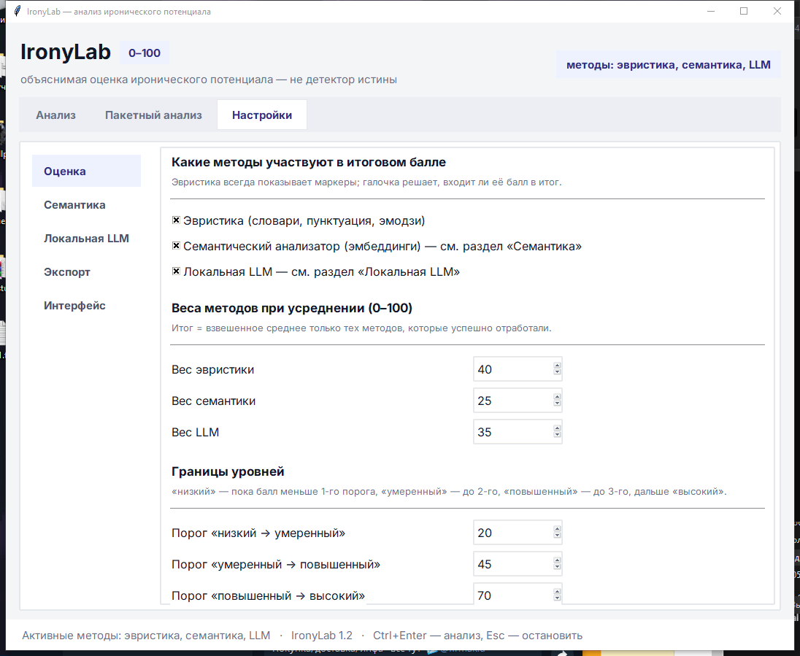

# Установка IronyLab: семантика и локальная языковая модель

Инструкция для тех, кому нужен **полный режим**: эвристика + семантический анализ
(эмбеддинги) + локальная БЯМ/LLM, которая работает офлайн и никуда не отправляет текст.

Проверено на Windows 10 (22H2), Python 3.13.5, Intel i5-12400F, NVIDIA RTX 3070
(драйвер 577.00), октябрь 2026. Команды для macOS и Linux — в разделе [8](#8-macos-и-linux).


## Содержание

1. [Что получится](#1-что-получится)
2. [Установка по шагам (Windows)](#2-установка-по-шагам-windows)
3. [Настройка в программе](#3-настройка-в-программе)
4. [Как это работает вместе](#4-как-это-работает-вместе)
5. [Что делать на слабом компьютере](#5-что-делать-на-слабом-компьютере)
6. [Экономия места](#6-экономия-места)
7. [Диагностика](#7-диагностика)
8. [macOS и Linux](#8-macos-и-linux)
9. [Офлайн-установка (аудитория без интернета)](#9-офлайн-установка-аудитория-без-интернета)
10. [Обновление и удаление](#10-обновление-и-удаление)

---

## 1. Что получится

| Режим | Что работает | Что скачивается | На диске |
|---|---|---|---|
| **Ядро** | эвристика, окно, CLI, CSV/JSON, тесты | ничего (только стандартный Python + Tkinter) | 0 |
| **+ Семантика** | контраст тональности и близость к иронии по эмбеддингам | `torch` CPU ≈ 200 МБ, `sentence-transformers` ≈ 10 МБ, модель ≈ 470 МБ | ≈ 0,7 ГБ |
| **+ Локальная LLM (CPU)** | «второе мнение» модели по тексту, офлайн | колесо ≈ 30 МБ + файл `.gguf` 1,1 ГБ | ≈ 1,2 ГБ |
| **+ Локальная LLM (NVIDIA)** | то же, в 5–15 раз быстрее | колесо ≈ 511 МБ + cudart/cublas из pip ≈ 925 МБ + `.gguf` 1,1 ГБ | ≈ 2,5 ГБ |

Итого полный режим с CUDA и моделью Qwen2.5-1.5B — **≈ 4 ГБ на диске**
(в сборке из этого репозитория: 2,9 ГБ библиотек и 1,5 ГБ моделей).
Всё скачивается один раз; сеть нужна только на установку, сам анализ идёт полностью локально.
Приёмы из [раздела 6](#6-экономия-места) убирают ещё ≈ 1,5 ГБ дубликатов.

---

## 2. Установка по шагам (Windows)

> **Про интерпретатор.** Все команды `python` и `pip` ниже должны выполняться **одним и тем
> же** интерпретатором. Перед шагом проверяйте, каким работаете:
> `python -c "import sys; print(sys.executable)"`. Если часть пакетов поставить в системный
> Python, а программу запускать из окружения (или наоборот), библиотеки «не найдутся» —
> они лежат там, куда их поставили. Посмотреть, где установлен пакет:
> `python -m pip show llama-cpp-python`.

### Шаг 0. Python

Нужен Python **3.10–3.13**, лучше 3.12 — самая предсказуемая совместимость колёс.
Установщик с [python.org](https://www.python.org/downloads/), галочка **Add python.exe to PATH**.
Tkinter входит в сборку с python.org.

```powershell
py --version
```

### Шаг 1. Виртуальное окружение

Откройте PowerShell в папке проекта: в Проводнике войдите в `IronyLab-course`, щёлкните
адресную строку, введите `powershell` и нажмите Enter.

**Сначала проверьте, нет ли окружения уже** — если проект пришёл вместе с библиотеками,
оно может лежать прямо в корне:

```powershell
Test-Path .\Scripts\python.exe        # True — окружение в корне готово, шаг 1 пропускается
Test-Path .\.venv\Scripts\python.exe  # True — готово окружение .venv
```

**Второе окружение создавать не нужно.** Если библиотеки уже стоят в одном окружении,
а рядом создать ещё одно, программа запустится «пустой»: семантика и локальная LLM напишут
«Не установлен sentence-transformers» и «Не установлен llama-cpp-python», хотя всё
установлено — просто не в том окружении. Проверить, чем вы работаете:

```powershell
python -c "import sys; print(sys.executable)"
```

Если окружения нет, создайте его:

```powershell
py -m venv .venv
.venv\Scripts\Activate.ps1                # если PowerShell ругается — см. примечание ниже
python -m pip install --upgrade pip
```

Чтобы не выбирать интерпретатор вручную, запускайте программу через `run.cmd`: он сам берёт
окружение из корня проекта или из `.venv` и печатает, каким интерпретатором работает.

```powershell
.\run.cmd                       # окно программы
.\run.cmd check_llm.py          # проверка локальной LLM
.\run.cmd cli.py --text "..."   # любой скрипт проекта
```

Примечание: если активация запрещена политикой, выполните один раз в этом окне

```powershell
Set-ExecutionPolicy -Scope Process -ExecutionPolicy Bypass
.venv\Scripts\Activate.ps1        # или .\Scripts\Activate.ps1, если окружение в корне проекта
```

Вместо активации можно просто вызывать интерпретатор напрямую: `.venv\Scripts\python.exe`
или `.\Scripts\python.exe`.

Примечание про pip: если команда `pip` висит без вывода или счётчик загрузки не растёт,
добавьте к ней флаги `--no-cache-dir --disable-pip-version-check`. Они отключают кэш pip
(он дублирует сотни мегабайт колёс и на части систем блокирует загрузку) и проверку
новой версии pip. Пример: `python -m pip install --no-cache-dir sentence-transformers`.

### Шаг 2. Ядро — ничего не требует

Эвристика, окно, CLI, экспорт работают сразу после шага 1.
Проверка: `python cli.py --text "Ну да, конечно, прекрасная погода — опять ливень."`

### Шаг 3. Семантика (эмбеддинги)

```powershell
python -m pip install torch --index-url https://download.pytorch.org/whl/cpu
python -m pip install sentence-transformers
```

Почему отдельной строкой: `pip install torch` по умолчанию тянет **CUDA-сборку ≈ 2,5 ГБ**,
а для эмбеддингов достаточно CPU-версии **≈ 200 МБ**. Семантика считается на процессоре
за доли секунды и не отбирает видеопамять у локальной модели.

Модель эмбеддингов скачается сама при первом анализе. По умолчанию —
`paraphrase-multilingual-MiniLM-L12-v2` (≈ 470 МБ, 50+ языков, включая русский).
Чтобы работать офлайн, скачайте её заранее:

```powershell
python -c "from huggingface_hub import snapshot_download as d; d('sentence-transformers/paraphrase-multilingual-MiniLM-L12-v2', local_dir='models/paraphrase-multilingual-MiniLM-L12-v2')"
```

Другие варианты (впишите имя в Настройки → Семантика):

| Модель | Размер | Комментарий |
|---|---|---|
| `paraphrase-multilingual-MiniLM-L12-v2` | 470 МБ | быстрая, годится для занятия |
| `intfloat/multilingual-e5-small` | 470 МБ | заметно точнее на русском |
| `sentence-transformers/LaBSE` | 1,8 ГБ | лучшее качество, в 4 раза медленнее |

### Шаг 4. Локальная LLM (`llama-cpp-python`)

Библиотека запускает файлы `.gguf` через `llama.cpp`. Компилятор не нужен — есть готовые колёса.

**Процессор (просто и надёжно):**

```powershell
python -m pip install llama-cpp-python --extra-index-url https://abetlen.github.io/llama-cpp-python/whl/cpu
```

**NVIDIA (быстрее в 5–15 раз).** Колесо содержит только ядро `llama.cpp`;
библиотеки CUDA 12 ставятся отдельными пакетами из pip, отдельный CUDA Toolkit не нужен:

```powershell
python -m pip install llama-cpp-python --extra-index-url https://abetlen.github.io/llama-cpp-python/whl/cu124
python -m pip install nvidia-cuda-runtime-cu12 nvidia-cublas-cu12

# cudart64_12.dll, cublas64_12.dll, cublasLt64_12.dll должны лежать рядом с llama.dll.
# Пути берём у того интерпретатора, которым ставили пакеты, — команда работает
# и для окружения .venv, и для окружения в корне, и для системного Python.
$site = python -c "import site; print(site.getsitepackages()[-1])"
$lib  = "$site\llama_cpp\lib"
$nv   = "$site\nvidia"
New-Item -ItemType HardLink -Path "$lib\cudart64_12.dll"   -Target "$nv\cuda_runtime\bin\cudart64_12.dll"
New-Item -ItemType HardLink -Path "$lib\cublas64_12.dll"   -Target "$nv\cublas\bin\cublas64_12.dll"
New-Item -ItemType HardLink -Path "$lib\cublasLt64_12.dll" -Target "$nv\cublas\bin\cublasLt64_12.dll"
```

Если `New-Item` пишет «не удаётся найти путь», значит пакеты стоят в другом окружении:
посмотрите, куда они легли (`python -m pip show llama-cpp-python`), и выполните эти же
команды тем интерпретатором, в который ставили.

Жёсткие ссылки не занимают дополнительное место (это те же файлы на диске). Если
файловая система не поддерживает ссылки, используйте `Copy-Item` — тогда добавится ≈ 735 МБ.

Другие индексы колёс: `cu121`, `cu122`, `cu123`, `cu125` — заменяют `cu124` в адресе;
для macOS (Apple Silicon) — `metal`.

**Проверка библиотеки:**

```powershell
python -c "import llama_cpp; print(llama_cpp.__version__)"
```

### Шаг 5. Модель `.gguf`

Файл кладётся в папку `models\`. Для русского языка берите Qwen2.5, Gemma 2/3 или
Llama 3.x в квантовании **Q4_K_M** — это лучший компромисс качества и размера.

| Модель | Файл | Размер | Для кого |
|---|---|---|---|
| Qwen2.5-0.5B-Instruct | `qwen2.5-0.5b-instruct-q4_k_m.gguf` | 0,4 ГБ | быстрый тест, качество слабое |
| **Qwen2.5-1.5B-Instruct** | `qwen2.5-1.5b-instruct-q4_k_m.gguf` | 1,1 ГБ | **стартовая, работает и на CPU** |
| Qwen2.5-3B-Instruct | `qwen2.5-3b-instruct-q4_k_m.gguf` | 2,0 ГБ | заметно лучше на русском |
| Qwen2.5-7B-Instruct | `qwen2.5-7b-instruct-q4_k_m.gguf` | 4,7 ГБ | 8 ГБ видеопамяти впритык |
| Llama-3.2-3B-Instruct | `Llama-3.2-3B-Instruct-Q4_K_M.gguf` | 2,0 ГБ | альтернатива Qwen |

Готовые репозитории: [Qwen2.5-1.5B](https://huggingface.co/Qwen/Qwen2.5-1.5B-Instruct-GGUF),
[Qwen2.5-3B](https://huggingface.co/Qwen/Qwen2.5-3B-Instruct-GGUF),
[Qwen2.5-7B](https://huggingface.co/Qwen/Qwen2.5-7B-Instruct-GGUF),
[Llama-3.2-3B](https://huggingface.co/bartowski/Llama-3.2-3B-Instruct-GGUF).

> **О качестве.** Модели 0,5–1,5B годятся как стартовые: они быстро отвечают, но часто
> ставят высокий балл нейтральным фразам («Заседание начинается в десять часов»).
> Для разметки корпуса и выводов берите 3B и больше — на RTX 3070 модель 7B в Q4
> помещается в 8 ГБ видеопамяти и работает в разы быстрее, чем на процессоре.

Скачать из командной строки (файл ~1,1 ГБ):

```powershell
New-Item -ItemType Directory -Force models | Out-Null
python -c "from huggingface_hub import hf_hub_download as d; print(d('Qwen/Qwen2.5-1.5B-Instruct-GGUF','qwen2.5-1.5b-instruct-q4_k_m.gguf', local_dir='models'))"
```

Или просто откройте страницу модели на Hugging Face → вкладка **Files** → скачайте нужный
`.gguf` и положите в `models\`. Яндекс Браузер/Edge умеют докачивать файл при обрыве связи.

### Шаг 6. Проверка

```powershell
# 1. Библиотеки на месте
python -c "import torch, sentence_transformers, llama_cpp; print('ok', torch.__version__, llama_cpp.__version__)"

# 2. Семантика (загрузит модель, ~2 с)
python check_semantic.py

# 3. Локальная LLM (загрузит .gguf и разберёт тестовую фразу)
python check_llm.py models\qwen2.5-1.5b-instruct-q4_k_m.gguf

# 4. Всё вместе через командную строку
python cli.py --text "Ну да, конечно, прекрасная погода — опять ливень." `
    --semantic models\paraphrase-multilingual-MiniLM-L12-v2 `
    --llm models\qwen2.5-1.5b-instruct-q4_k_m.gguf
```

Ожидаемый результат `check_llm.py`: `Модель загружена за ~1 с`, затем строка вида
`Генерация 1.2 с -> 65/100: выраженная ирония (класс C): ...`. На CPU загрузка займёт 3–10 с,
генерация — 2–5 с на каждый прогон.

Проверка на контрольных фразах через движок программы (Qwen2.5-1.5B, 3 прогона):

| Фраза | Эвристика | Семантика | LLM | Итог |
|---|---|---|---|---|
| Заседание начинается в десять часов. | 0 | 0 | **10** | 6 |
| Сохраните файл в кодировке UTF-8 и отправьте на проверку. | 0 | 6 | **10** | 8 |
| Мне очень понравился фильм, рекомендую. | 0 | 4 | **10** | 8 |
| Опять сломался принтер, это очень неприятно. | 0 | 15 | **28** | 23 |
| Спасибо, что предупредил заранее, очень вовремя. | 0 | 80 | **35** | 54 |
| Ну да, конечно, прекрасная погода — опять ливень. | 45 | 100 | **65** | 80 |
| Прекрасно, опять сломался принтер! | 28 | 88 | **55** | 69 |
| Молодец, ничего не скажешь. | 0 | 55 | **90** | 75 |

Балл модели перестал быть «двоичным»: 10 у буквальных фраз, 28–35 при сомнении,
55–65 у выраженной иронии, 90 у резкого сарказма. **Скрытую иронию** 1,5B всё ещё
пропускает (фраза про «заранее предупреждённого» получает класс A в части прогонов) —
здесь выручает семантика. Для разметки корпуса берите 3B и больше.

---

## 3. Настройка в программе

Быстрый способ — один скрипт: он включает семантику и локальную LLM и подставляет пути
к уже скачанным моделям. Прежний файл настроек сохраняется рядом как `settings.json.bak`.

```powershell
python configure_local_models.py                       # модели из папки models\
python configure_local_models.py путь\к\модели путь\к\файл.gguf --cpu
```



Дальше — то же самое вручную. Запустите `python app.py` (или `.\Scripts\python.exe app.py`)
и откройте вкладку **Настройки** — разделы переключаются списком слева.

**Оценка** — включите нужные методы:

- ☑ Эвристика (словари, пунктуация, эмодзи) — вес 40;
- ☑ Семантический анализатор — вес 25;
- ☑ Локальная LLM — вес 35.

Итог = взвешенное среднее **только успешно отработавших** методов; если модель не
загрузилась, метод пропускается, а причина появляется в блоке «Предупреждения».
Веса 0–100, они не обязаны давать в сумме 100.

**Семантика** — поле «Папка / имя модели»: `paraphrase-multilingual-MiniLM-L12-v2`
(по умолчанию) или путь `models\paraphrase-multilingual-MiniLM-L12-v2`.
Устройство: `cpu` (быстро и без конкуренции за видеопамять).
Кнопка **«Проверить модель»** загружает её и печатает результат на тестовой фразе.

**Локальная LLM** — поле «Путь к модели»: `models\qwen2.5-1.5b-instruct-q4_k_m.gguf`
(кнопка «Файл…» открывает проводник). Параметры:

| Параметр | CPU-сборка | RTX 3070 8 ГБ | Смысл |
|---|---|---|---|
| Контекст (n_ctx) | 2048 | 4096 | больше — больше памяти |
| Потоки CPU | 0 (авто) | 0 | i5-12400F: 6 производительных ядер |
| Слоёв на GPU | **0** | **-1** | `-1` — все слои на видеокарту |
| Температура | 0,1 | 0,1 | при нескольких прогонах поднимается минимум до 0,4, иначе прогоны совпадут |
| Макс. токенов | 256 | 256 | хватает на JSON с пояснением |
| Прогонов на текст | **1** | **3** | 1 — быстрее, 3 — дробнее оценка и видно сомнения модели |

Кнопка **«Проверить модель»** покажет ответ модели на тестовой фразе — это самый
быстрый способ понять, что путь и параметры верны.

Модель загружается один раз при первом анализе и остаётся в памяти: первый текст
обрабатывается дольше, последующие — быстро.

---

## 4. Как это работает вместе

1. **Эвристика** находит наблюдаемые маркеры: «ну да, конечно», контраст оценки и
   ситуации, кавычки, `!!!`, эмодзи, гиперболу. Всегда включена и показывает объяснения.
2. **Семантика** считает два сигнала на эмбеддингах: полярный контраст между частями
   фразы («прекрасная погода» ↔ «опять ливень») и близость к набору ироничных образцов.
3. **Локальная LLM** получает текст как данные внутри ограничителей `<<< >>>` и выбирает класс:
   `A` — буквальное высказывание, `B` — слабая ирония, `C` — выраженная ирония, `D` — сарказм.
   Балл считается в коде по классу (10 / 35 / 65 / 90), поэтому ответ модели не зависит от того,
   какое число она «запомнила» из инструкции. Вопрос задаётся несколько раз (по умолчанию 3),
   итог — среднее прогонов: оценка получается дробной (18, 28, 55…), а расхождение прогонов
   видно в пояснении как `[прогоны: C, A, C]`.

Ни один из трёх сигналов не является «детектором истины»: ирония зависит от контекста
и адресата. Значения семантики не откалиброваны — их удобно сравнивать между текстами,
а веса подбирать на своём размеченном корпусе.

---

## 5. Что делать на слабом компьютере

- Если локальная LLM не нужна, пропустите [шаг 4](#шаг-4-локальная-llm-llama-cpp-python):
  семантика нетребовательна к железу и даёт заметный прирост качества по сравнению
  с одной эвристикой.
- Для LLM берите модель 0,5–1,5B в Q4_K_M и `n_gpu_layers = 0`.
- Уменьшите `Макс. длина текста для семантики/LLM` (Настройки → Оценка) до 500–800 символов:
  длинные тексты всё равно обрезаются, а время растёт линейно.
- В пакетном режиме понизьте `n_ctx` до 1024 — для коротких реплик этого достаточно.

---

## 6. Экономия места

- `torch` ставится CPU-сборкой: **−2,3 ГБ** против стандартной установки.
- Флаг `--no-cache-dir` не даёт pip дублировать колёса в кэше: **−1,5 ГБ**.
- CUDA-библиотеки подключаются жёсткими ссылками: **−735 МБ**.
- Колесо `llama-cpp-python` кладёт библиотеки `llama.cpp` **дважды** — в
  `site-packages\bin` и в `site-packages\llama_cpp\lib`. Модуль читает вторую копию,
  поэтому копии можно связать жёсткими ссылками: **−890 МБ**.

  ```powershell
  $site = python -c "import site; print(site.getsitepackages()[-1])"
  $bin = "$site\bin"; $lib = "$site\llama_cpp\lib"
  Get-ChildItem $bin -Filter *.dll | ForEach-Object {
      $dst = Join-Path $lib $_.Name
      Remove-Item -Force $dst -ErrorAction SilentlyContinue
      New-Item -ItemType HardLink -Path $dst -Target $_.FullName | Out-Null
  }
  python check_llm.py      # убедитесь, что модель по-прежнему загружается
  ```

- В папке модели можно удалить `pytorch_model.bin`, если есть `model.safetensors`,
  и каталог `openvino` (нужен только для OpenVINO): **−1 ГБ**.
- Лишние модели в `models\` удаляются простым удалением файла.

Проверить, что занимает место:

```powershell
Get-ChildItem .venv -Recurse -File | Measure-Object -Sum Length | ForEach-Object { "{0:N1} ГБ" -f ($_.Sum/1GB) }
Get-ChildItem models -Recurse -File | Measure-Object -Sum Length | ForEach-Object { "{0:N1} ГБ" -f ($_.Sum/1GB) }
```

---

## 7. Диагностика

| Симптом | Причина | Решение |
|---|---|---|
| Семантика и LLM «отвалились»: в предупреждениях «Не установлен sentence-transformers» или «Не установлен llama-cpp-python» | программа запущена не тем интерпретатором: пакеты стоят в другом окружении (например, в системном Python, а запуск из `.venv`) | `python -c "import sys; print(sys.executable)"`, `python -m pip show llama-cpp-python`; запускайте через `run.cmd` (см. [шаг 1](#шаг-1-виртуальное-окружение)) |
| `pip install` висит без вывода, счётчик загрузки не растёт | повреждённый кэш pip или проблемы с системным прокси | добавьте `--no-cache-dir --timeout 30 --retries 2`; проверьте прокси (Параметры → Сеть → Прокси): pip ходит через него, а `curl` — напрямую; как крайний случай скачайте колесо curl-ом и поставьте из файла |
| `Microsoft Visual C++ 14.0 or greater is required` | pip пытается собрать llama-cpp-python из исходников | используйте `--extra-index-url .../whl/cpu` и `--only-binary=:all:` |
| `Failed to load shared library ... llama.dll` | CUDA-колесо не находит `cudart64_12.dll` / `cublas64_12.dll` | выполните подключение CUDA из [шага 4](#шаг-4-локальная-llm-llama-cpp-python) или поставьте колесо `cpu` |
| `CUDA error: no kernel image is available`, падение при загрузке модели | драйвер NVIDIA старше 2024 года | обновите драйвер или возьмите колесо `cpu` |
| `Модель не найдена: ...` | неверный путь в Настройки → Локальная LLM | укажите файл `.gguf` кнопкой «Файл…» |
| Модель грузится, но ответ пустой или не JSON | модель слишком слабая / мало токенов | возьмите 3B и больше, `Макс. токенов ответа` ≥ 256 |
| `System role not supported` | шаблон чата без роли system (Gemma) | не ошибка: программа повторит запрос без system |
| `Не установлен sentence-transformers` | не выполнен [шаг 3](#шаг-3-семантика-эмбеддинги) | `python -m pip install sentence-transformers` |
| Семантика молчит, хотя галочка стоит | пустое поле модели или нет сети при первом запуске | впишите имя модели, проверьте интернет или скачайте модель заранее |
| Скачивание модели с Hugging Face обрывается | большой файл, нестабильная сеть | `curl.exe -L -C - -o models\файл.gguf <прямая ссылка>` — `-C -` докачивает |
| Анализ идёт медленно | LLM считает на CPU или `n_ctx` слишком большой | `Слоёв на GPU = -1`, `n_ctx = 2048`, модель 1,5B |
| Окно не открывается, ошибка Tkinter | Python без Tkinter (Linux: пакет `python3-tk`) | поставьте Tkinter или используйте `cli.py` |

Полезно для отчёта об ошибке:

```powershell
python -c "import sys,platform;print(sys.version, platform.platform())"
python -m pip list
```

---

## 8. macOS и Linux

Шаги те же, отличается только установка LLM-библиотеки и ускорения.

### macOS (Apple Silicon)

```bash
cd ~/IronyLab-course
python3 -m venv .venv && source .venv/bin/activate
python -m pip install --upgrade pip
python -m pip install torch --index-url https://download.pytorch.org/whl/cpu
python -m pip install sentence-transformers
# Metal: инференс на GPU Apple
python -m pip install llama-cpp-python --extra-index-url https://abetlen.github.io/llama-cpp-python/whl/metal
python check_semantic.py
python check_llm.py models/qwen2.5-1.5b-instruct-q4_k_m.gguf
python app.py
```

Если Tkinter отсутствует (сборка из Homebrew), поставьте `brew install python-tk`.

### Linux (CPU или NVIDIA)

```bash
sudo apt install python3-tk            # Tkinter для окна программы
python3 -m venv .venv && source .venv/bin/activate
python -m pip install --upgrade pip
python -m pip install torch --index-url https://download.pytorch.org/whl/cpu
python -m pip install sentence-transformers
# CUDA:
python -m pip install llama-cpp-python --extra-index-url https://abetlen.github.io/llama-cpp-python/whl/cu124
# или без видеокарты:
# python -m pip install llama-cpp-python --extra-index-url https://abetlen.github.io/llama-cpp-python/whl/cpu
python cli.py --text "Ну да, конечно, прекрасная погода — опять ливень."
```

На Linux колесо CUDA работает сразу: библиотеки `libcudart.so.12` и `libcublas.so.12`
ищутся в системе. Если их нет, поставьте CUDA Toolkit 12 или пакеты
`nvidia-cuda-runtime-cu12` / `nvidia-cublas-cu12` через pip.

---

## 9. Офлайн-установка (аудитория без интернета)

На машине с интернетом соберите папку с колёсами:

```powershell
python -m pip download -r requirements.txt -d wheelhouse `
    --extra-index-url https://abetlen.github.io/llama-cpp-python/whl/cu124 `
    --index-url https://download.pytorch.org/whl/cpu
```

Скопируйте на целевую машину: папку `wheelhouse`, файл `.gguf` и папку модели
эмбеддингов из `models\`. Затем там:

```powershell
py -m venv .venv
.venv\Scripts\python.exe -m pip install --no-index --find-links wheelhouse -r requirements.txt
```

В настройках укажите пути к локальным моделям, а при необходимости задайте
переменные окружения, чтобы библиотеки не пытались выйти в сеть:

```powershell
$env:HF_HUB_OFFLINE = "1"
$env:TRANSFORMERS_OFFLINE = "1"
```

---

## 10. Обновление и удаление

Обновить библиотеки:

```powershell
.venv\Scripts\python.exe -m pip install --upgrade -r requirements.txt `
    --extra-index-url https://abetlen.github.io/llama-cpp-python/whl/cpu
```

Удалить окружение целиком (настройки и модели останутся):

```powershell
Remove-Item -Recurse -Force .venv
```

Удалить модели: `Remove-Item -Recurse models`. Файл настроек программы —
`%APPDATA%\IronyLab\settings.json` (на macOS/Linux — `~/.config/ironylab/settings.json`).
Переменная `IRONYLAB_CONFIG` позволяет указать другой путь, например для занятия:

```powershell
$env:IRONYLAB_CONFIG = "$PWD\lesson-settings.json"
python app.py
```
