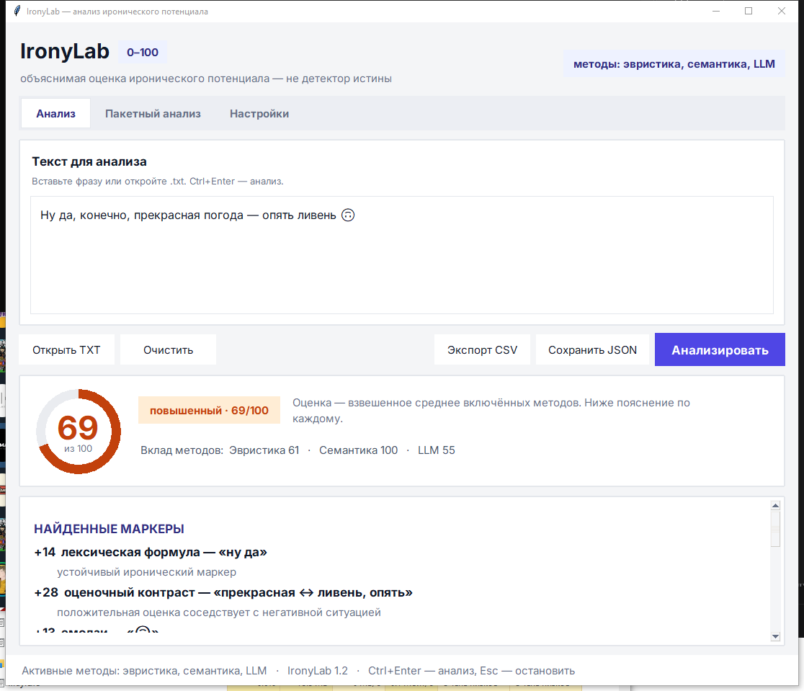
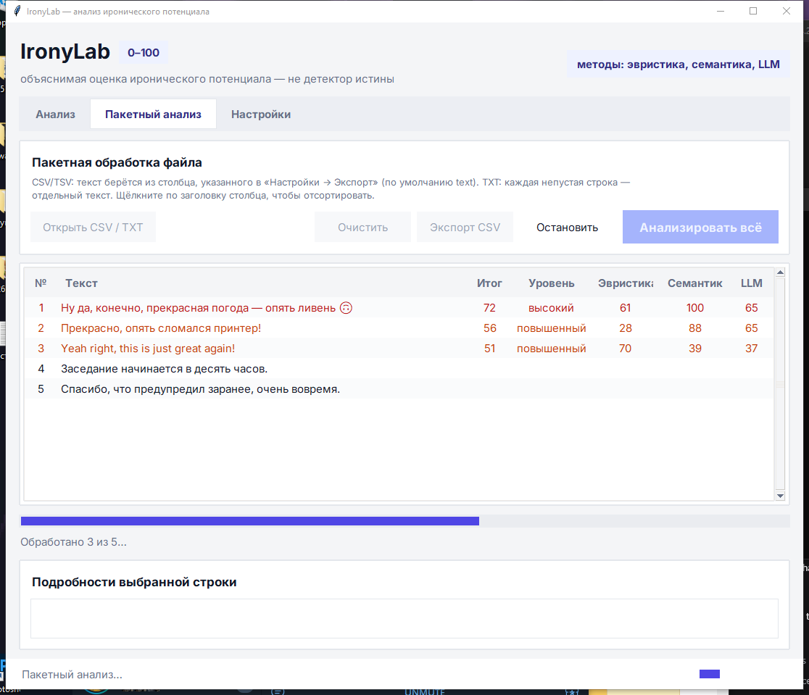

# IronyLab — учебная утилита для анализа иронии

IronyLab оценивает **иронический потенциал** русского или английского текста по шкале 0–100 и объясняет результат. Это не «детектор истины»: ирония зависит от контекста, автора и адресата, поэтому вывод программы — гипотеза для разметки и обсуждения.



В проекте есть:

- оконное приложение (`app.py`);
- лаунчер `run.cmd`, который сам выбирает окружение с библиотеками;
- командная строка (`cli.py`);
- обработка `.txt` и таблиц `.csv`;
- экспорт результата в JSON/CSV;
- **семантический анализатор** (эмбеддинги) и **локальная LLM** — необязательные, включаются в настройках;
- вкладки «Анализ», «Пакетный анализ» и «Настройки» в окне программы;
- современный интерфейс: шрифт Inter, сегментированная навигация, круговой индикатор балла,
  вертикальные вкладки настроек, индикатор работы в строке состояния;
- карточка результата с баллом, уровнем, вкладом методов и цветными пояснениями;
- сортировка таблицы пакетного анализа по любому столбцу (щелчок по заголовку);
- горячие клавиши: `Ctrl+Enter` — анализ, `Esc` — остановить пакетную обработку;
- скрипты проверки `check_semantic.py` и `check_llm.py`;
- тесты;
- Colab-ноутбук;
- сборка самостоятельного приложения для macOS и Windows.

## Что требуется

- Python 3.10–3.13 (для урока лучше 3.12);
- `pytest` — только для тестов;
- `pyinstaller` — только для сборки;
- Tkinter и остальные рабочие модули входят в стандартный Python с python.org.

Работа самой программы не требует сторонних библиотек и сети. Список зависимостей для разработки находится в `requirements-dev.txt`.

Полный режим (**семантика + локальная LLM**) разобран по шагам в
**[INSTALL_RU.md](INSTALL_RU.md)** — там же выбор моделей, разбор типичных ошибок,
офлайн-установка и экономия места. Всю установку на Windows выполняет один скрипт:

```powershell
powershell -ExecutionPolicy Bypass -File install.ps1
```

Проверка компонентов после установки: `python check_semantic.py`, `python check_llm.py`.
Файлы `requirements.txt` (семантика + LLM) и `requirements-dev.txt` (тесты и сборка)
содержат списки пакетов.

## 1. Быстрый запуск

Если проект уже пришёл с установленными библиотеками (в корне есть папки `Scripts` и `Lib`
или окружение `.venv`), ничего ставить не нужно — запускайте одной командой:

```powershell
.\run.cmd            # окно программы; лаунчер сам выбирает нужное окружение
.\run.cmd check_llm.py
```

### macOS

Откройте Terminal (`Cmd + Space` → `Terminal`) и выполните:

```bash
cd ~/Documents/IronyLab
python3 --version
python3 -m venv .venv
source .venv/bin/activate
python -m pip install --upgrade pip
python -m pip install -r requirements-dev.txt
python app.py
```

После активации окружения слева в строке обычно видно `(.venv)`. Завершить работу окружения: `deactivate`.

Если `python3` не найден, установите Python 3.12 с [python.org](https://www.python.org/downloads/) и повторите команды. На macOS при установке из python.org Tkinter уже включён.

### Windows 10/11

Установите Python 3.12 с [python.org](https://www.python.org/downloads/), отметив **Add python.exe to PATH**. Откройте PowerShell в папке проекта: в Проводнике войдите в `IronyLab`, щёлкните адресную строку, введите `powershell` и нажмите Enter.

```powershell
py --version
py -m venv .venv
.venv\Scripts\Activate.ps1
python -m pip install --upgrade pip
python -m pip install -r requirements-dev.txt
python app.py
```

Если PowerShell запрещает активацию, один раз в этом окне выполните:

```powershell
Set-ExecutionPolicy -Scope Process -ExecutionPolicy Bypass
.venv\Scripts\Activate.ps1
```

Либо используйте обычную командную строку (`cmd`):

```bat
.venv\Scripts\activate.bat
```

## 2. Командная строка

Анализ одной фразы:

```bash
python cli.py --text "Ну да, конечно, прекрасная погода — опять ливень."
```

Анализ файла и сохранение JSON:

```bash
python cli.py --file examples/sample.txt --json result.json
```

Пакетный анализ CSV (нужен столбец `text`):

```bash
python cli.py --csv examples/sample.csv --out results.csv
```

Справка по всем аргументам:

```bash
python cli.py --help
```

## 2а. Семантика и локальная LLM (необязательно)

Без этих компонентов программа работает как раньше. Итоговый балл — взвешенное среднее включённых методов; если метод недоступен (нет модели, ошибка), он пропускается, а причина показывается в предупреждениях.

Установка в два шага (подробно — в [INSTALL_RU.md](INSTALL_RU.md)):

```powershell
python -m pip install torch --index-url https://download.pytorch.org/whl/cpu
python -m pip install sentence-transformers
python -m pip install llama-cpp-python --extra-index-url https://abetlen.github.io/llama-cpp-python/whl/cpu
```

**Локальная LLM** — вкладка «Настройки → Локальная LLM», поле «Путь к модели»:

- файл `.gguf` (Llama, Qwen, Gemma, Mistral и т. п.) — нужен `pip install llama-cpp-python`;
- папка модели Hugging Face — нужны `pip install transformers torch`.

Модель загружается один раз при первом анализе и работает полностью офлайн. Кнопка «Проверить модель» загружает её и показывает ответ на тестовую фразу. Для слабого компьютера берите модель 1–4 млрд параметров в квантовании Q4; для русского языка лучше подходят Qwen2.5/Gemma/Llama 3.x. Если на Windows `pip install llama-cpp-python` пытается компилироваться и падает, используйте готовые колёса: `pip install llama-cpp-python --extra-index-url https://abetlen.github.io/llama-cpp-python/whl/cpu` (для NVIDIA — `.../whl/cu124` плюс `nvidia-cuda-runtime-cu12` и `nvidia-cublas-cu12`).

**Семантика** — вкладка «Настройки → Семантика»: путь к папке (или имя на Hugging Face) многоязычной модели `sentence-transformers`, по умолчанию `paraphrase-multilingual-MiniLM-L12-v2` (скачается при первом запуске). Нужен `pip install sentence-transformers`. Считаются два сигнала: контраст тональности между частями фразы («прекрасная погода» ↔ «опять ливень») и близость к образцам ироничных высказываний. Значения не откалиброваны — используйте их для сравнения и экспериментов, подберите веса на своём корпусе.

Текст для LLM передаётся как данные внутри ограничителей, а ответ разбирается устойчиво. Модель выбирает **класс**, а не число: `A` — буквальное высказывание, `B` — слабая ирония, `C` — выраженная ирония, `D` — сарказм; базовый балл (10 / 35 / 65 / 90) считается в коде. Так сделано потому, что маленькие модели «залипают» на числе из инструкции: если попросить балл «от 0 до 100», они возвращают 100 почти на любой текст, включая вопросы и инструкции. В инструкции есть пример-якорь на каждый класс — без них модель использует только два. По умолчанию вопрос задаётся 3 раза (`Прогонов на текст`), итог — среднее: оценка получается дробной (например 18, 28 или 55), а расхождение прогонов показывает, что модель сомневается, и печатается в пояснении как `[прогоны: C, A, C]`. Своя инструкция в настройках может вернуть и число `score` — такой ответ тоже принимается.

Командная строка использует те же настройки; их можно переопределить:

```bash
python cli.py --text "Ну да, конечно!" --llm "D:\models\qwen2.5-3b-q4.gguf"
python cli.py --csv examples/sample.csv --out results.csv --semantic "D:\models\minilm" --no-llm
```

## 2б. Настройки и экспорт CSV

Настройки хранятся в `%APPDATA%\IronyLab\settings.json` (в другом месте: переменная `IRONYLAB_CONFIG`). Доступны: включение методов и их веса, границы уровней, лимит длины текста, параметры моделей (путь, контекст, потоки, слои на GPU, температура, длина ответа, своя инструкция), формат CSV (разделитель, кодировка, столбец с текстом, оценка по предложениям), размер шрифта.

Экспорт CSV есть на вкладке «Анализ» (один текст) и «Пакетный анализ» (файл `.csv`/`.txt` целиком, с таблицей результатов).



По умолчанию используется разделитель `;` и UTF-8 с BOM — так файл корректно открывается двойным щелчком в русском Excel; для других программ смените разделитель на «,». Столбцы: исходные столбцы файла, `score`, `level`, `heuristic_score`, `semantic_score`, `llm_score`, `signals`, `semantic_note`, `llm_explanation`, `warnings`. Тексты, начинающиеся с `=`, `+`, `-`, `@`, экранируются апострофом, чтобы Excel не выполнил их как формулу. При импорте распознаются UTF-8 и Windows-1251.

## 3. Проверка

```bash
python -m pytest -q
python -m compileall ironylab app.py cli.py
python smoke_gui.py            # окно собирается, результат и таблица рисуются (окно скрыто)
python check_semantic.py       # семантика: модель загружается, тестовая фраза оценивается
python check_llm.py            # локальная LLM: .gguf загружается, ответ разбирается
```

Документацию удобно читать в браузере: `python md_to_html.py INSTALL_RU.md` создаёт рядом
автономный `INSTALL_RU.html` со встроенными стилями (так же можно открыть `README.md`
и `LESSON_PLAN_RU.md`).

Ожидается сообщение о пройденных тестах и отсутствие ошибок компиляции. Ручная проверка:

1. Запустите `python app.py`.
2. Вставьте «Прекрасно, опять сломался принтер!».
3. Нажмите «Анализировать».
4. Убедитесь, что видны балл, уровень, найденные маркеры и предложения.
5. Проверьте нейтральный контроль: «Заседание начинается в десять часов».

## 4. Сборка приложения для друзей

PyInstaller не является кросс-компилятором: `.app` собирают на Mac, `.exe` — на Windows. Получателю Python не потребуется.

### macOS

```bash
source .venv/bin/activate
python -m PyInstaller --noconfirm --clean --windowed --onedir --name IronyLab app.py
```

Готовое приложение: `dist/IronyLab.app`. Для пересылки сначала сожмите `.app` в ZIP. На чужом Mac из-за отсутствия подписи может потребоваться: правый клик → **Открыть** → **Открыть**. Для публичного распространения нужна подпись Apple Developer и notarization.

### Windows

```powershell
.venv\Scripts\Activate.ps1
python -m PyInstaller --noconfirm --clean --windowed --onedir --name IronyLab app.py
```

Передавайте целиком папку `dist\IronyLab` в ZIP. Запускаемый файл — `IronyLab.exe`. Режим `--onedir` выбран потому, что его проще диагностировать; после проверки можно заменить его на `--onefile`.

Готовые сценарии делают то же самое:

- macOS: `bash build_mac.sh`
- Windows: `build_windows.bat`

## 5. Google Colab

Загрузите `IronyLab_Colab.ipynb` в [Google Colab](https://colab.research.google.com/), затем выполняйте ячейки сверху вниз (`Shift + Enter`). Ноутбук автономен (это версия 1.0 без семантики и LLM): он создаёт модуль анализа прямо в сессии Colab и позволяет загрузить `.txt`/`.csv`, скачать результат и провести мини-эксперимент.

## Как считается оценка

Алгоритм ищет наблюдаемые признаки: формулы вроде «ну да, конечно», контраст положительной оценки с негативной ситуацией, кавычки, многократную пунктуацию, гиперболу, междометия и некоторые эмодзи. У каждого признака есть вес. Сумма ограничивается диапазоном 0–100, а предложения ранжируются отдельно.

Это удобно для обучения: учащиеся могут менять словари и веса в `ironylab/analyzer.py`, затем проверять гипотезы на размеченном корпусе. Но оценку нельзя выдавать за психологический диагноз или объективное свойство высказывания.

## Идея занятия на 90 минут

1. 0–10 мин — постановка задачи и проблема контекста.
2. 10–25 мин — запуск в Colab, три контрольных примера.
3. 25–45 мин — чтение `analyzer.py`, добавление собственного маркера.
4. 45–60 мин — CLI, виртуальное окружение, `.txt` и `.csv`.
5. 60–75 мин — оконный интерфейс и тесты.
6. 75–85 мин — сборка приложения.
7. 85–90 мин — обсуждение ошибок, корпуса и метрик precision/recall/F1.

Подробный сценарий преподавателя: `LESSON_PLAN_RU.md`.

